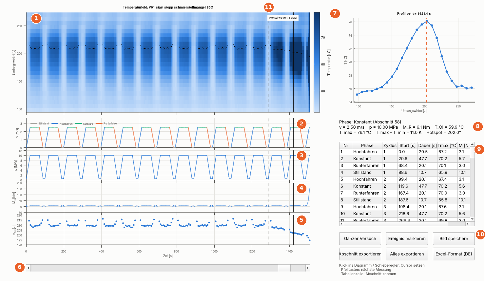
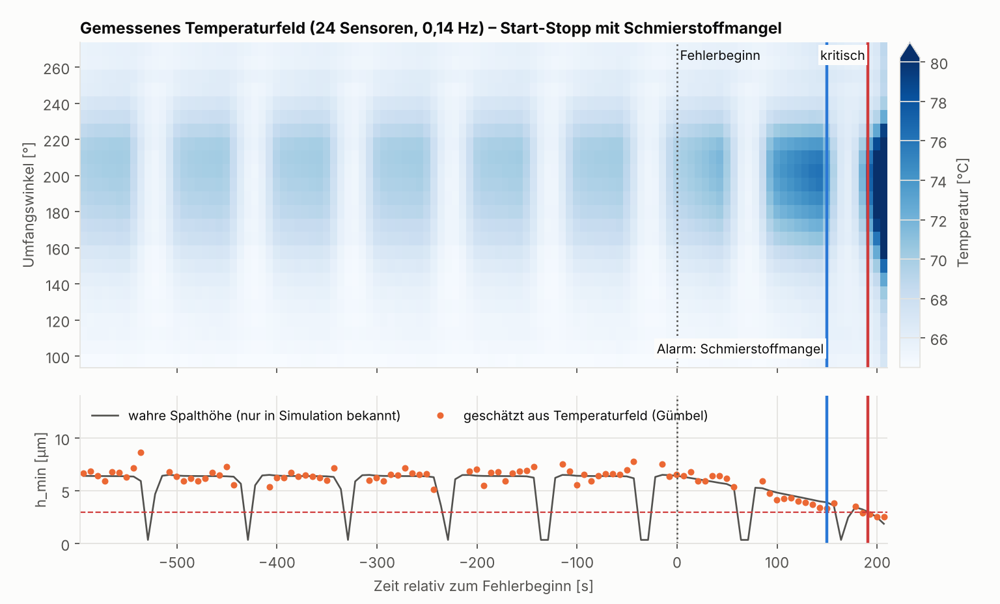

# Gleitlager: Zustandsüberwachung aus dem Temperaturfeld

Zwei zusammengehörige Projekte zur **temperaturbasierten Zustandsüberwachung von
sensorintegrierenden Gleitlagern**: ein Werkzeug, um Prüfstandsversuche aufzubereiten
und anzusehen, und eine Studie, mit welchen Kriterien man Schäden früh erkennt.

> **Hinweis:** Privates Lernprojekt, kein offizielles Projekt eines Instituts.
> Alle Daten sind **synthetisch**, angelehnt an die veröffentlichten Prüfstandsparameter
> aus [Baszenski et al. (2025)](https://doi.org/10.1007/s10010-025-00917-9).

## 1. Prüfstands-Viewer (MATLAB): [`gleitlager-pruefstand-viewer/`](gleitlager-pruefstand-viewer/)

Liest Lagertemperaturen und Prüfstandsdaten ein, auch im deutschen Excel-Format und mit
unterschiedlicher Abtastrate. Zerlegt Versuche automatisch in Betriebsphasen
(Stillstand, Hochfahren, Konstant, Runterfahren, Lastwechsel) und zeigt alles in
einer interaktiven Oberfläche. Läuft in MATLAB und GNU Octave, ohne Toolboxen.



## 2. Schadensfrüherkennung (Python + C): [`gleitlager-cm/`](gleitlager-cm/)

Simuliert gesunde Läufe und Fehlerfälle (Schmierstoffmangel, Verschleiß, Überlast,
Sensordefekt) und vergleicht fünf Erkennungskriterien. Die beste Kombination erkennt
60 von 60 Schäden ohne Fehlalarm, 40 davon vor dem kritischen Zustand. Die Auswertung
läuft zusätzlich als C-Code für einen Mikrocontroller (1,5 kB RAM).



## Schnellstart

```matlab
% MATLAB (Command Window)
cd gleitlager-pruefstand-viewer
start_demo
```

```
# Python (Terminal)
cd gleitlager-cm
pip install -r requirements.txt
python run_all.py
```

Details stehen in den READMEs der beiden Ordner.

---

Entwickelt von Arif Onur Alp mit Unterstützung von Claude (KI-Assistent). Lizenz: MIT.
