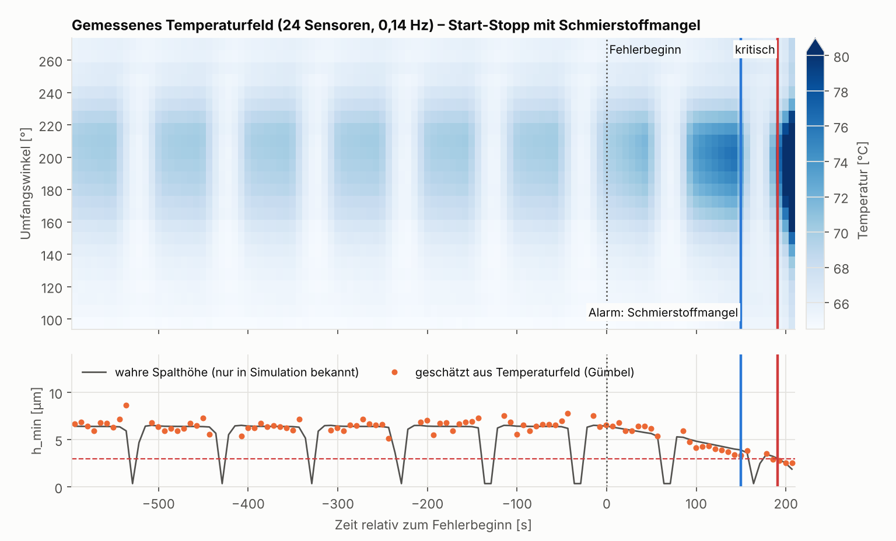
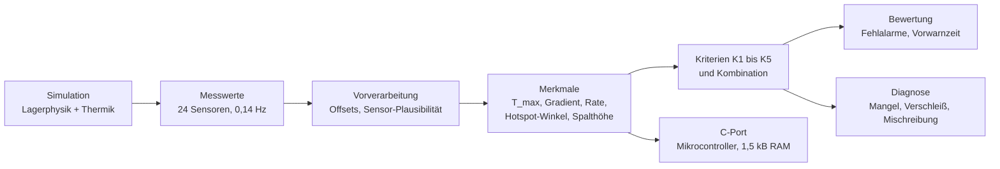
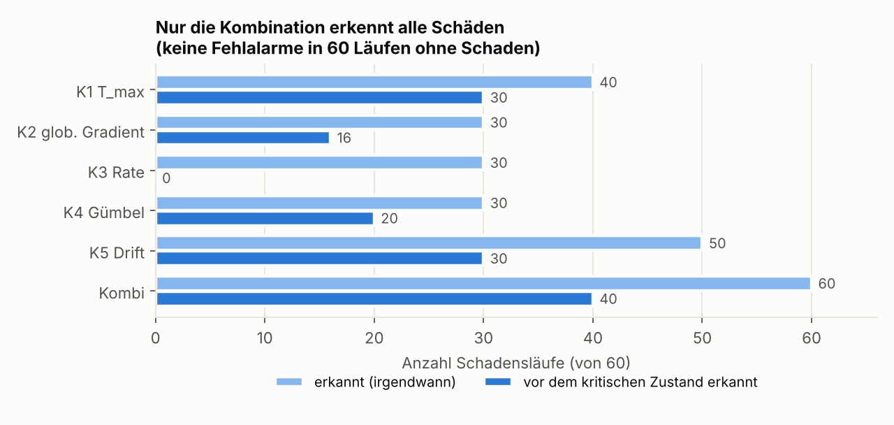
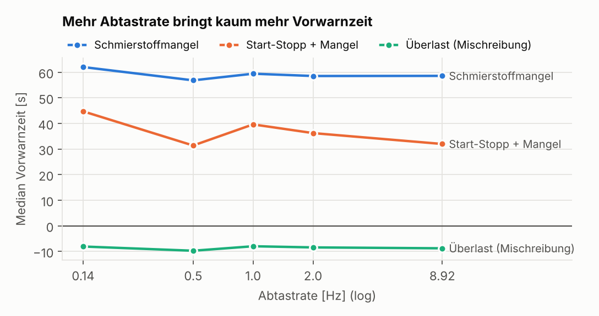
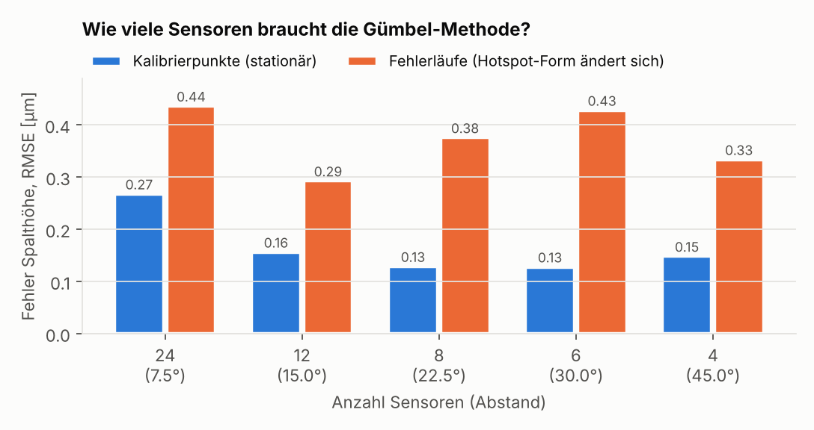
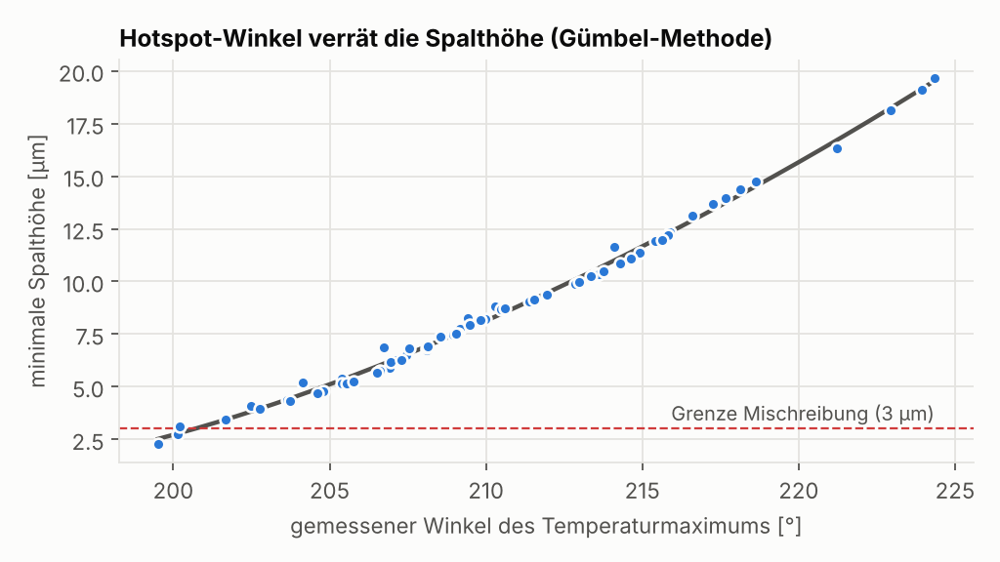

# gleitlager-cm: Schadensfrüherkennung aus dem Temperaturfeld

Ein Analyseprojekt zur **temperaturbasierten Zustandsüberwachung von Gleitlagern**.
Es reicht vom Rohsignal von 24 Temperatursensoren über Merkmale und Erkennungskriterien
bis zu einer **C-Implementierung für einen Mikrocontroller**.

> **Hinweis:** Privates Lernprojekt, kein offizielles Projekt eines Instituts.
> Alle Daten sind **synthetisch**. Ein vereinfachtes physikalisches Modell erzeugt
> sie, angelehnt an die veröffentlichten Parameter des sensorintegrierenden
> Gleitlagers aus [Baszenski et al. (2025)](https://doi.org/10.1007/s10010-025-00917-9).



*Oben: gemessenes Temperaturfeld (Zeit × Umfangswinkel, dunkel = heiß) im
Start-Stopp-Betrieb. Ab t = 0 bricht die Ölversorgung langsam ein. Unten: die aus dem
Temperaturfeld geschätzte Spalthöhe (orange) im Vergleich zur wahren Spalthöhe (grau).
Der Alarm (blau) kommt rund 40 s, bevor es kritisch wird (rot).*

---

## Kurz erklärt

In einem Gleitlager trägt ein dünner Ölfilm die Welle. Wird er zu dünn, berühren sich
Welle und Lager (**Mischreibung**), es entsteht Verschleiß, im schlimmsten Fall ein
Fresser. Das Lager hier misst mit 24 Sensoren die Temperatur entlang des Umfangs.

Die Frage: **Mit welchen Regeln erkennt man aus diesen Temperaturen früh genug, dass
etwas schiefgeht, ohne ständig Fehlalarm zu geben?**

Dafür macht das Projekt vier Dinge:

1. Es **simuliert** gesunde Läufe und Fehlerfälle: Schmierstoffmangel, Verschleiß,
   Überlast und Sensordefekt.
2. Es **berechnet Merkmale** aus dem Temperaturfeld, z.B. die heißeste Stelle und
   wie schnell es wärmer wird.
3. Es **vergleicht fünf Erkennungskriterien** und eine Kombination daraus, an
   frischen Läufen, die beim Entwickeln nicht benutzt wurden.
4. Es **portiert** die Auswertung nach C, damit sie auf dem Mikrocontroller im Lager
   laufen könnte.

## Ablauf



| Kriterium | Idee |
|---|---|
| K1 T_max | höchste Temperatur über einem Grenzwert |
| K2 globaler Gradient | Unterschied zwischen heißester und kältester Stelle zu groß |
| K3 Temperaturrate | es wird zu schnell wärmer |
| K4 Gümbel-Spalthöhe | aus dem Winkel der heißesten Stelle die Ölfilmdicke schätzen; Alarm, wenn sie zu klein wird |
| K5 Drift | langsame, gleichmäßige Erwärmung über Minuten |
| Kombi | K3 oder K4 oder K5, mit Plausibilitätsprüfung der Sensoren |

## Ergebnisse

Bewertet auf **10 frischen Läufen je Szenario** (synthetische Daten, 0,14 Hz).
Alle Zahlen: [`results/ergebnisse.md`](results/ergebnisse.md).

| | Ergebnis |
|---|---|
| Schäden erkannt (Kombination) | 60 / 60 |
| davon vor dem kritischen Zustand | 40 / 60 |
| Fehlalarme in Läufen ohne Schaden | 0 / 60 (inkl. Start-Stopp, Lastwechsel, Sensorfehler) |
| Diagnose richtig (Mangel / Verschleiß / Mischreibung) | 60 / 60 |
| Sensorfehler erkannt, ohne Schadensalarm | 10 / 10 |



**Was zeigt das Bild?** Für jedes Kriterium zeigt der helle Balken, wie viele der 60
Schadensläufe überhaupt erkannt wurden, und der dunkle, wie viele *rechtzeitig*, also
vor dem kritischen Zustand. Einzelne Kriterien sehen jeweils nur einen Teil der
Fehlerbilder. Erst die Kombination erkennt alle. Fehlalarme gab es bei keinem Kriterium.

### Erkenntnisse

1. **Kein Einzelkriterium reicht.** Die Rate (K3) schlägt erst an, wenn es schon
   zu spät ist. Die Drift (K5) findet langsamen Verschleiß, aber keine plötzliche
   Mischreibung.
2. **Mischreibung durch Überlast sieht man nicht an der Temperatur.** T_max ändert sich
   kaum (≈ 72,6 → 73 °C), aber die heißeste Stelle wandert um ~7° Richtung Lastzone.
   Nur die Gümbel-Methode erkennt das.
3. **Gümbel braucht einen deutlichen Hotspot.** Bei kaltem Öl und niedriger Drehzahl
   ist er nur ~0,9 K ausgeprägt, der Winkel wird verrauscht und es gab Fehlalarme.
   Abhilfe: eine Mindest-Ausprägung von 1,5 K.
4. **Thermische Trägheit.** Bei plötzlicher Überlast bleibt das Temperaturmaximum
   ~40 s am alten Ort, obwohl der Spalt schon kleiner wird. Der Alarm kommt deshalb
   im Mittel ~8 s *nach* Beginn der Mischreibung.
5. **Mehr Abtastrate bringt kaum Vorwarnzeit** (siehe unten), weil das Temperaturfeld
   selbst träge ist.
6. **Sensoren müssen auf Plausibilität geprüft werden.** Ein defekter Sensor springt
   allein, ein echter Hotspot erwärmt auch die Nachbarn. Ohne diese Prüfung würde ein
   Sensordefekt als Schaden gemeldet.
7. **Numerik auf dem Mikrocontroller:** Das Gümbel-Polynom auf rohen Winkeln
   (φ⁴ ≈ 1,6·10⁹) ist in 32-bit-float unbrauchbar, deshalb wird der Winkel vorher normiert.

### Abtastrate



**Was zeigt das Bild?** Die mittlere Vorwarnzeit für drei Fehlerbilder bei Abtastraten
von 0,14 Hz (wie im echten, energieautarken System) bis 8,92 Hz (Maximum des Sensors).
Die Kurven bleiben in derselben Größenordnung: Schneller messen hilft hier kaum, weil
sich das Temperaturfeld nur über Sekunden bis Minuten ändert. Bei Überlast liegt die
Vorwarnzeit bei jeder Rate leicht unter null, wegen der thermischen Trägheit (Punkt 4).

### Sensoranzahl



**Was zeigt das Bild?** Den Fehler der geschätzten Spalthöhe, wenn man nur 24, 12, 8,
6 oder 4 der Sensoren nutzt: blau an ruhigen Kalibrierpunkten, orange in Fehlerläufen,
wo sich die Form des Hotspots ändert. Im Modell reichen schon 6 bis 12 Sensoren.
*Vorbehalt:* Das Modell hat eine ideal glatte Hotspot-Form. Mit echten Messdaten
müsste man das wiederholen.

### Gümbel-Kalibrierung



**Was zeigt das Bild?** Jeder Punkt ist ein ruhiger Betriebspunkt (verschiedene
Drehzahlen, Lasten und Öltemperaturen). Je näher die heißeste Stelle an der Lastzone
liegt (kleinerer Winkel), desto dünner ist der Ölfilm. Ein Polynom 4. Ordnung
übersetzt den Winkel in eine Spalthöhe (Fehler ≈ 0,24 µm). Unter der roten Linie
(3 µm) beginnt die Mischreibung.

## Grenzen

- **Synthetische Daten:** Kurzlagertheorie, stark vereinfachte Thermik, idealisierte
  Fehlerbilder. Die Zahlen zeigen, ob die *Methode* funktioniert, nicht wie gut sie am
  echten Lager ist.
- Die Diagnoseregeln sind an eigenen Entwicklungsläufen entstanden. Validiert sind sie
  auf frischen Läufen, aber aus demselben Modell.
- Was als „kritisch“ zählt, ist eine Annahme: Reibmoment +50 % oder Spalthöhe unter 3 µm.

## Ausführen

Windows (PowerShell, im Projektordner):

```
py -m pip install -r requirements.txt
py -m pytest tests                 # 8 Grundlagentests
py run_all.py                      # komplette Auswertung, ca. 3-5 min, schreibt results/
```

Linux / macOS: dieselben Befehle mit `python3` statt `py`.

Der C-Port wird mit `python c/vergleich_python_c.py` kompiliert und gegen Python
geprüft. Dafür braucht man den C-Compiler gcc, z.B. unter Linux oder WSL.

## Aufbau

```
sipb/physics.py       Gleitlagerphysik (Viskosität, Sommerfeldzahl, Kurzlager, Reibung)
sipb/simulate.py      Szenarien und synthetisches Temperaturfeld
sipb/features.py      Vorverarbeitung, Plausibilität, Hotspot, Gümbel, Merkmale
sipb/experiments.py   Versuchsplan, Schwellen, Bewertung, Diagnoseregeln
run_all.py            komplette Auswertung und Abbildungen
c/                    C-Implementierung für den Mikrocontroller + Vergleichstest
tests/                Grundlagentests
results/              Ergebnisse, Abbildungen, Beispiel-CSV
```

## Verwandtes Projekt

[gleitlager-pruefstand-viewer](../gleitlager-pruefstand-viewer):
MATLAB-Werkzeug, das Prüfstandsversuche einliest, in Betriebsphasen zerlegt und
interaktiv anzeigt.

## Quellen

- J. T. Baszenski et al.: *Experimental and simulative investigation of an
  energy-autarkic, temperature field-based Sensor-integrating Plain Bearing focusing
  transient operating conditions.* Forschung im Ingenieurwesen 89, 140 (2025).
  https://doi.org/10.1007/s10010-025-00917-9
- J. Paeßens et al.: *Design of a fully integrated sensor system of a plain bearing.*
  Forschung im Ingenieurwesen 88, 17 (2024). https://doi.org/10.1007/s10010-024-00740-8
- DIN 31652 (Sommerfeldzahl, effektive Temperatur); Kurzlagertheorie nach Ocvirk.

---

Entwickelt von Arif Onur Alp mit Unterstützung von Claude (KI-Assistent).
Lizenz: MIT, siehe [LICENSE](../LICENSE).
