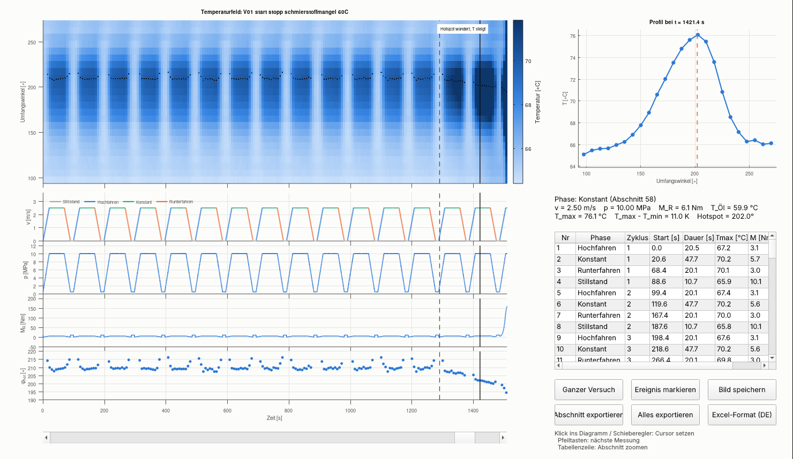
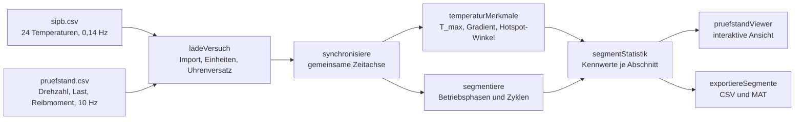
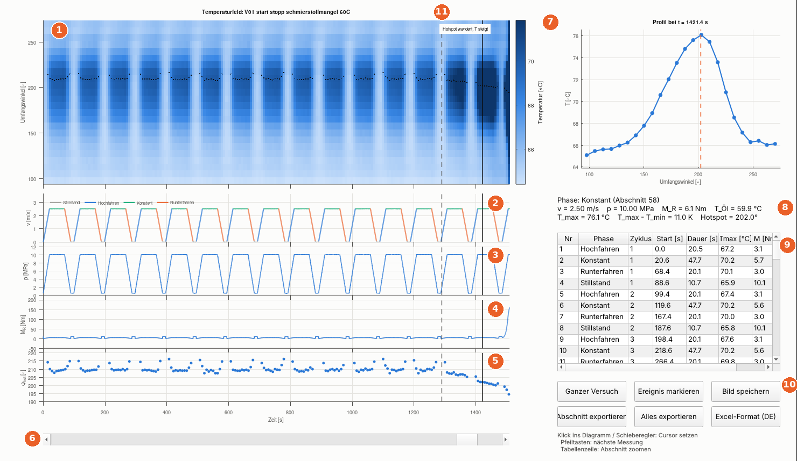
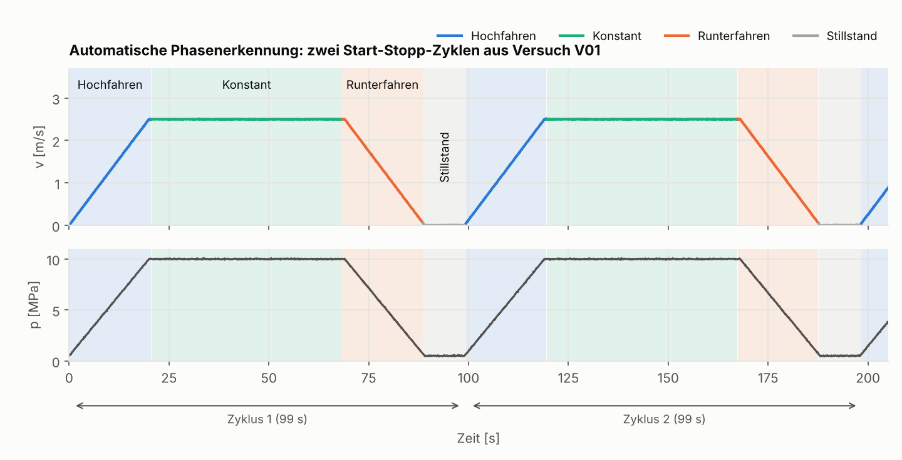
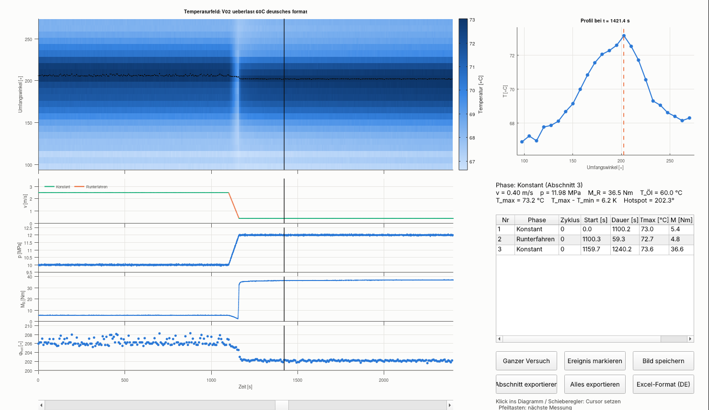

# Gleitlager-Prüfstands-Viewer (MATLAB)

Ein MATLAB-Werkzeug, das Versuchsdaten eines **sensorintegrierenden Gleitlagers**
einliest, automatisch in **Betriebsphasen** zerlegt und **interaktiv anzeigt**.
Es läuft auch in GNU Octave und braucht keine Toolboxen.

> **Hinweis:** Privates Lernprojekt, kein offizielles Projekt eines Instituts.
> Alle Daten sind **synthetisch**. Erzeugt wurden sie mit dem Simulationsmodell aus
> [gleitlager-cm](../gleitlager-cm), angelehnt an die
> veröffentlichten Prüfstandsparameter aus
> [Baszenski et al. (2025)](https://doi.org/10.1007/s10010-025-00917-9).



---

## Worum geht es?

In einem Gleitlager dreht sich eine Welle auf einem dünnen Ölfilm. Bei einem
**sensorintegrierenden Gleitlager** sitzen 24 Temperatursensoren entlang des Umfangs
in der Lagerschale. Aus diesem **Temperaturfeld** lässt sich ablesen, wie es dem
Lager geht. Ein Beispiel: Die Lage der heißesten Stelle (**Hotspot**) verrät, wie
dünn der Ölfilm ist.

Am Prüfstand entstehen dabei **zwei Datenströme**:

| Quelle | Inhalt | typische Abtastrate |
|---|---|---|
| Sensorsystem im Lager | 24 Temperaturen | 0,14 Hz (alle 7 s), weil energieautark |
| Prüfstand | Drehzahl, Last, Reibmoment, Öltemperatur | 10 Hz und mehr |

Bevor man Kriterien zur **Schadensfrüherkennung** ableiten kann, müssen diese Daten
eingelesen, zeitlich zusammengeführt und nach Betriebszustand sortiert werden.
Genau das macht dieses Werkzeug.

## So funktioniert es



1. **Import:** Liest Komma-CSV und deutsches Excel-Format (Semikolon, Dezimalkomma),
   erkennt Spalten am Namen und rechnet Einheiten um (Drehzahl → Gleitgeschwindigkeit,
   Radialkraft → spezifische Last).
2. **Synchronisieren:** Legt die Prüfstandswerte auf die Zeitpunkte der Temperaturmessung.
   Geht die Uhr des Sensorsystems vor oder nach, korrigiert das eine Zeile in
   `einstellungen.txt`.
3. **Merkmale:** Berechnet für jede Messung höchste und niedrigste Temperatur,
   globalen Gradienten und den **Hotspot-Winkel**. Letzterer kommt aus einer Parabel
   durch die drei heißesten Nachbarsensoren, damit er genauer ist als der
   Sensorabstand von 7,5°.
4. **Phasen:** Zerlegt den Versuch in Stillstand, Hochfahren, Konstant, Runterfahren
   und Lastwechsel (siehe unten).
5. **Ansicht und Export:** Zeigt alles zusammen an und schreibt jeden Abschnitt als
   eigene CSV-Datei.

## Der Viewer, Bereich für Bereich



| Nr. | Bereich | Was man sieht |
|---|---|---|
| 1 | **Temperaturfeld** | Zeit (x) gegen Umfangswinkel (y), dunkel = heiß. Die schwarzen Punkte zeigen den Hotspot-Winkel. Jeder dunkle Block ist eine Phase unter Last. |
| 2 | **Gleitgeschwindigkeit** | eingefärbt nach erkannter Betriebsphase |
| 3 | **Last** | spezifische Lagerlast in MPa |
| 4 | **Reibmoment** | am Ende von V01 steigt es stark an: Folge des Schmierstoffmangels |
| 5 | **Hotspot-Winkel** | wandert er Richtung Lastzone (kleinere Winkel), wird der Ölfilm dünner |
| 6 | **Schieberegler und Cursor** | wählt eine Messung; alternativ ins Diagramm klicken oder Pfeiltasten |
| 7 | **Temperaturprofil** | Temperatur entlang des Umfangs zur Cursorzeit, gestrichelt der Hotspot |
| 8 | **aktuelle Werte** | Phase, Geschwindigkeit, Last, Reibmoment, Öl- und Lagertemperatur |
| 9 | **Abschnittstabelle** | Klick auf eine Zeile zoomt auf diesen Abschnitt |
| 10 | **Knöpfe** | Ereignis markieren, Bild speichern, Abschnitt oder alles exportieren (auch im deutschen Excel-Format) |
| 11 | **markiertes Ereignis** | eigene Notiz zu einem Zeitpunkt, gespeichert in `ereignisse.csv` |

## Phasenerkennung



`segmentiere` arbeitet nur mit Geschwindigkeit und Last:

- Die Geschwindigkeit wird über 1 s geglättet, die Ableitung über ein Fenster von 2 s
  gebildet. So stört Messrauschen nicht.
- **Stillstand**, wenn v < 0,05 m/s. **Hochfahren** oder **Runterfahren**, wenn sich v
  schneller als 1 % der Nenngeschwindigkeit pro Sekunde ändert.
- **Lastwechsel**, wenn bei konstanter Geschwindigkeit die Last steigt oder fällt.
- Abschnitte unter 3 s werden dem Nachbarn zugeschlagen, z.B. kurze Signalaussetzer.
- Jedes Hochfahren aus dem Stillstand beginnt einen neuen **Zyklus**.

Im Beispiel liegen die erkannten Grenzen höchstens 1 s neben den wahren Grenzen des
99-s-Zyklus (20 s hoch, 49 s konstant, 20 s runter, 10 s Stillstand). Alle Schwellen
lassen sich in `src/konfiguration.m` einstellen.

## Was man damit sehen kann

**V01, Schmierstoffmangel im Start-Stopp-Betrieb** (Bild ganz oben): Ab ca. 1280 s
bricht die Ölversorgung ein. Das Temperaturfeld wird von Zyklus zu Zyklus dunkler,
der Hotspot wandert von ~210° auf unter 200°, und am Ende schnellt das Reibmoment hoch.

**V02, Überlast:** Die Drehzahl sinkt, die Last steigt, das Lager gerät in Mischreibung.



Das Reibmoment springt auf etwa das 7-Fache, die höchste Lagertemperatur ändert sich
aber kaum (≈ 73 °C). Erkennbar ist die Mischreibung vor allem am **Hotspot-Winkel**,
der von ~206° auf ~202° wandert. Ein reiner Temperaturgrenzwert würde diesen Zustand
übersehen.

## Schnellstart

Die Befehle gehören ins **Command Window von MATLAB** (oder Octave), nicht in die
Windows-PowerShell.

```matlab
cd Gleitlager/gleitlager-pruefstand-viewer
start_demo                     % Beispielversuch V01 im Viewer öffnen
```

Ohne Oberfläche, z.B. in eigenen Skripten:

```matlab
addpath('src')
cfg = konfiguration();
versuch = ladeVersuch('beispieldaten/V02_ueberlast_60C_deutsches_format', cfg);
[versuch, seg, m] = analysiereVersuch(versuch, cfg);
struct2table(seg)              % Abschnitte als Tabelle (MATLAB)
exportiereSegmente(versuch, seg, m, 'export');
stapelExport('beispieldaten')  % alle Versuche auf einmal + uebersicht.csv
```

## Eigene Daten

Ein Versuch ist ein Ordner mit zwei CSV-Dateien und optional einer Einstellungsdatei:

```
mein_versuch/
├── sipb.csv            Lagertemperaturen
├── pruefstand.csv      Prüfstandsdaten
└── einstellungen.txt   optional
```

`sipb.csv` (Komma-Format):
```
zeit_s,T01_degC,T02_degC,...,T24_degC
0.00,64.56250,64.71875,...,65.46875
```

`pruefstand.csv` darf auch im deutschen Excel-Format sein, mit Drehzahl statt
Geschwindigkeit und Kraft statt Last:
```
Zeit [s];Drehzahl [1/min];Radialkraft [kN];Reibmoment [Nm];Öltemperatur Zulauf [°C]
0,00;397,19;36,022;5,440;60,09
```

`einstellungen.txt`:
```
# Die Uhr des Sensorsystems geht 12 s vor
zeitversatz_s = -12
```

Die Spaltennamen müssen nicht exakt so heißen. Die Erkennung läuft über reguläre
Ausdrücke in `src/konfiguration.m` (`cfg.spalten.*`). Dort stehen auch Lagergeometrie,
Sensorwinkel (Standard: 24 Sensoren von 97,5° bis 270°), Sensor-Offsets und die
Schwellen der Phasenerkennung.

## Beispieldaten

| Versuch | Inhalt | Besonderheit |
|---|---|---|
| `V01_start_stopp_schmierstoffmangel_60C` | 16 Start-Stopp-Zyklen, Öl 60 °C, Mangel ab ~1280 s | endet mit starkem Reibmomentanstieg |
| `V02_ueberlast_60C_deutsches_format` | Drehzahl sinkt, Last steigt → Mischreibung | deutsches Excel-Format, Drehzahl in 1/min, Kraft in kN |
| `V03_start_stopp_gesund_20C` | 13 Zyklen, Öl 20 °C, ohne Schaden | Sensoruhr geht 12 s vor (`einstellungen.txt`) |

## Tests

```matlab
cd tests
run_alle_tests          % ohne Oberfläche
run_alle_tests(true)    % zusätzlich Oberfläche öffnen und alle Knöpfe auslösen
```

17 Tests prüfen:
- Import: Komma/Semikolon, BOM, Lücken, Textspalten
- Spaltenerkennung und Einheitenumrechnung
- Uhrenversatz und Synchronisation
- Phasenerkennung: mit Rauschen, Signalaussetzern und Lastwechseln
- Hotspot-Berechnung
- Export im deutschen Format, Ereignisse, Stapelexport, Messlücken
- die Oberfläche

Getestet mit GNU Octave 8.4 (17 von 17 bestanden). Der Code nutzt nur Funktionen,
die es auch in MATLAB ohne Toolboxen gibt.

## Aufbau

```
start_demo.m                Beispiel öffnen
src/konfiguration.m         alle Einstellungen
src/ladeCsv.m               robuster CSV-Import
src/ladeVersuch.m           Versuch laden: zwei Quellen, Einheiten, Uhrenversatz
src/synchronisiere.m        Prüfstandswerte auf Temperaturzeitpunkte
src/segmentiere.m           Betriebsphasen und Zyklen
src/temperaturMerkmale.m    Kennwerte des Temperaturfelds, Hotspot-Winkel
src/analysiereVersuch.m     alle Schritte zusammen
src/segmentStatistik.m      Kennwerte je Abschnitt
src/exportiereSegmente.m    CSV- und MAT-Export
src/stapelExport.m          ganzen Ordner auswerten
src/ereignisse.m            Ereignisse laden und speichern
src/pruefstandViewer.m      Oberfläche
tests/run_alle_tests.m      Tests
beispieldaten/              drei synthetische Versuche
werkzeuge/                  Erzeugung der Beispieldaten (Python)
docs/                       Bilder für diese Anleitung
```

## Ideen für später

- Uhrenversatz automatisch schätzen, z.B. über Start- und Stopp-Zeitpunkte in beiden
  Quellen. Die thermische Verzögerung muss man dabei berücksichtigen.
- Spalthöhe nach der Gümbel-Methode als eigene Kurve anzeigen.
- Automatischer Bericht mit einer Seite je Versuch.

## Verwandtes Projekt

[gleitlager-cm](../gleitlager-cm): Simulationsmodell und
Vergleich von Kriterien zur Schadensfrüherkennung (Python, C für Mikrocontroller).

## Quellen

- J. T. Baszenski et al.: *Experimental and simulative investigation of an
  energy-autarkic, temperature field-based Sensor-integrating Plain Bearing focusing
  transient operating conditions.* Forschung im Ingenieurwesen 89, 140 (2025).
  https://doi.org/10.1007/s10010-025-00917-9

---

Entwickelt von Arif Onur Alp mit Unterstützung von Claude (KI-Assistent).
Lizenz: MIT, siehe [LICENSE](../LICENSE).
